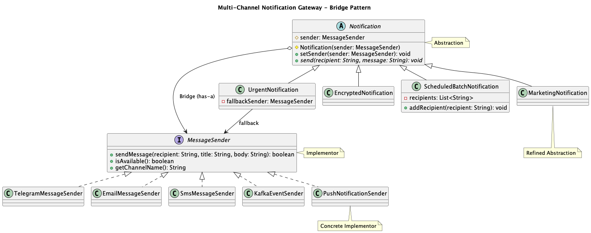

# Assignment 3 — Multi-Channel Notification Gateway

**Course:** Software Design Patterns  
**Pattern:** Bridge  
**Language:** Java 17+

## 1. Project Description

In this assignment, I created a simple notification system using the Bridge Pattern.

The system supports different types of notifications and different message senders. The main idea is to separate notification types from message delivery channels.

All message senders are simulated. Real APIs are not used.

## 2. Bridge Pattern Implementation

My project has two main parts:

**Abstraction:** `Notification`

The notification classes are:
- `UrgentNotification`
- `EncryptedNotification`
- `ScheduledBatchNotification`
- `MarketingNotification`

**Implementor:** `MessageSender`

The message senders are:
- `TelegramMessageSender`
- `EmailMessageSender`
- `SmsMessageSender`
- `KafkaEventSender`
- `PushNotificationSender`

## 3. Main Features

- Urgent notifications with fallback support
- Base64 message encoding
- Batch notifications with delivery statistics
- Runtime switching between message senders
- SMS length restriction of 160 characters
- Independent extension of notification types and senders

## 4. Demo Scenarios

The `Main.java` class demonstrates six scenarios:

1. Urgent Notification with Telegram
2. Encrypted Notification with Email
3. Scheduled Batch Notification with SMS
4. Runtime switching from Telegram to Email
5. Telegram unavailable, fallback to SMS
6. Marketing Notification with Push

## 5. Why Bridge Pattern?

**1. What are the two independent dimensions?**

The two dimensions are notification types and message delivery providers.

**2. Where exactly is the Bridge?**

The Bridge is the `MessageSender sender` field inside the `Notification` class. It connects notification types with message senders.

**3. Why is inheritance problematic here?**

Without Bridge, I would need separate classes for every combination, such as `UrgentTelegramNotification` and `UrgentEmailNotification`. This would create too many classes.

**4. What happens when a new provider is added?**

I can create a new class that implements `MessageSender`. I do not need to change existing notification classes.

**5. What happens when a new Notification type is added?**

I can create a new class that extends `Notification`. I do not need to change existing sender classes.

**6. Why is this Bridge rather than Adapter?**

Bridge separates two parts of the system so they can change independently. Adapter is used to make incompatible interfaces work together.

## 6. UML Class Diagram

The UML diagram shows the two class hierarchies and the Bridge relationship.



The source diagram is available in `diagram.puml`.

## 7. How to Run

Compile the project:

```bash
mvn clean compile
```

Run the application:

```bash
java -cp target/classes Main
```

Run the unit tests:

```bash
mvn clean test
```

## 8. Unit Testing

I created 12 JUnit 5 tests to check successful delivery, unavailable providers, fallback, SMS length restriction, Base64 encoding, batch notifications, runtime switching, Push, Marketing, and failure scenarios.

**Test results:**
- Tests run: 12
- Failures: 0
- Errors: 0
- Skipped: 0

## 9. Conclusion

In this assignment, I learned how to use the Bridge Pattern to separate abstraction from implementation. I also practiced Java interfaces, abstract classes, inheritance, composition, and JUnit testing.

The main advantage of Bridge is that I can add new notification types and message senders independently without creating a separate class for every combination.